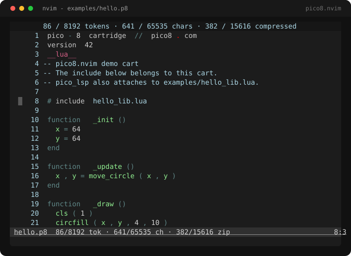

# Getting started

This guide takes you from a clean Neovim configuration to a working PICO-8
editing session in about five minutes. It uses the pinned `pico-lsp` v1.8.1
server and `pico8.nvim` v0.1.0.



## What you need

- Neovim 0.11.4 or newer. This release is tested with 0.11.4 and 0.12.6.
- A `pico-lsp` v1.8.1 or newer binary. A release archive does not require Go.
  The v1.8.1 release covers the core client. `gq` and Neovim 0.12 `gx` need a
  newer server build with M33; `gf` is the fallback.
- Optional: a C compiler if you want the editor-only Tree-sitter parser.
- PICO-8 0.2.7 if you want to run carts. It is not required to edit carts, and
  this plugin does not run them.

You do **not** need to clone this repository, install Mason, or install
`nvim-treesitter`.

## 1. Install the server

Download the archive for your OS and architecture from the
[`pico-lsp` v1.8.1 release](https://github.com/asimmons91/pico-lsp/releases/tag/v1.8.1)
and put `pico-lsp` on `PATH`. Or, with Go 1.27.4 or newer:

```sh
go install github.com/asimmons91/pico-lsp/cmd/pico-lsp@v1.8.1
```

Verify the binary from the shell:

```sh
pico-lsp --version
```

The full per-OS instructions, checksums, Windows `.zip`, macOS Gatekeeper,
offline use, upgrade, uninstall, and `GOBIN`/`PATH` guidance are in the
[`pico-lsp` installation guide](https://github.com/asimmons91/pico-lsp/blob/main/docs/install.md).

## 2. Install the plugin

### lazy.nvim or LazyVim

Add this to `lua/plugins/pico8.lua`:

```lua
return {
  {
    "asimmons91/pico8.nvim",
    tag = "v0.1.0",
    main = "pico_lsp",
    lazy = false,
    opts = {},
  },
}
```

`lazy = false` is required so `ftdetect`, `ftplugin`, and `syntax` are available
before the first cart opens. `opts = {}` calls `require("pico_lsp").setup()`.

### vim.pack on Neovim 0.12+

```lua
vim.pack.add({
  { src = "https://github.com/asimmons91/pico8.nvim", version = "v0.1.0" },
})
require("pico_lsp").setup()
```

### Vanilla Neovim

```lua
vim.opt.runtimepath:append("/path/to/pico8.nvim")
require("pico_lsp").setup()
```

Keep `filetype plugin on` enabled. There is no `plugin/` entry: installing the
plugin alone does not register commands, start the include helper, or install
PNG auto-open. `setup()` does that.

## 3. Open a cart

The repository demo has two code tabs and includes `hello_lib.lua`:

```sh
nvim examples/hello.p8
```

Put the cursor on `hello_lib.lua` in the `#include` line and press `gf`, or run
`:Pico8OpenCart` from the include to return to the cart.

If you installed the plugin through a plugin manager and do not have a
checkout, copy the [demo cart](../examples/hello.p8) and its
[include](../examples/hello_lib.lua) to a directory. Or save this minimal cart
as `hello.p8` and open it:

```pico8
pico-8 cartridge // pico8.com
version 42
__lua__
function _init()
 x=64
 y=64
end

function _update()
 if btn(➡️) then x+=1 end
 if btn(⬅️) then x-=1 end
 if btn(⬆️) then y-=1 end
 if btn(⬇️) then y+=1 end
end

function _draw()
 cls(1)
 circfill(x,y,4,10)
 print("hello pico8.nvim",2,2,7)
end
__gfx__
00000000000000000000000000000000000000000000000000000000000000000000000000000000000000000000000000000000000000000000000000000000
```

## 4. Verify

Run:

```vim
:checkhealth pico_lsp
```

A healthy report shows:

- Neovim 0.11.4 or newer;
- a loaded `vim.lsp.config["pico_lsp"]`;
- the resolved `pico-lsp` executable and a successful `--version` probe;
- one attached `pico_lsp` client with the cart directory as its root;
- the cart budget lens and inlay-hint state;
- the helper commands and no `lua_ls` conflict;
- the optional Tree-sitter parser state.

Health is read-only. It does not start a client, download a server, or install a
parser.

If no client attaches, check `:set filetype?` and
`:lua =vim.lsp.get_clients({ bufnr = 0 })`, then see
[Troubleshooting](troubleshooting.md#client-does-not-attach).

## 5. Try these

- Hover over `circfill` or `x` and run completion on `circ`.
- Add a misspelled PICO-8 API call and watch the diagnostic.
- Look at the cart budget code lens and statusline. Run `:Pico8CartInfo`.
- Run `:Pico8Tabs` and pick the second tab.
- Put the cursor on `#include hello_lib.lua` and press `gf`.
- Run `:Pico8InsertGlyph left` or `:Pico8InsertGlyph 139`.
- Optional: run `:Pico8InstallParser` and start Tree-sitter with the
  [auto-start snippet](install.md#tree-sitter).
- Optional: inspect a `.p8.png` cart read-only with `nvim cart.p8.png`.

## What this is not

- It does not run, compile, or emulate carts.
- It does not replace the PICO-8 editor. It edits the same `.p8` and `.lua`
  files that PICO-8 loads.
- It does not provide the Lua standard library. Only the PICO-8 0.2.7 API is
  modeled.
- It does not write to `.p8.png` carts. PNG carts are read-only.
- It does not install `pico-lsp` or the Tree-sitter parser automatically.

## Next steps

- [Installation](install.md): pinned install, upgrade, uninstall, and Tree-sitter.
- [Usage](usage.md): includes, PNG carts, glyphs, formatting, and statusline.
- [Configuration](configuration.md): plugin options and server settings.
- [Troubleshooting](troubleshooting.md): attach, binary, LuaLS, and font issues.
- [Roadmap](ROADMAP.md): release and distribution plans.
